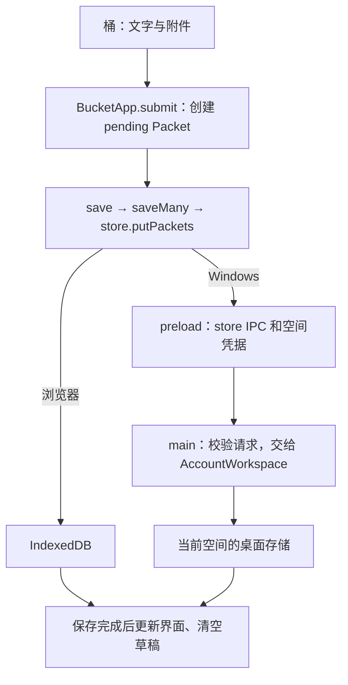
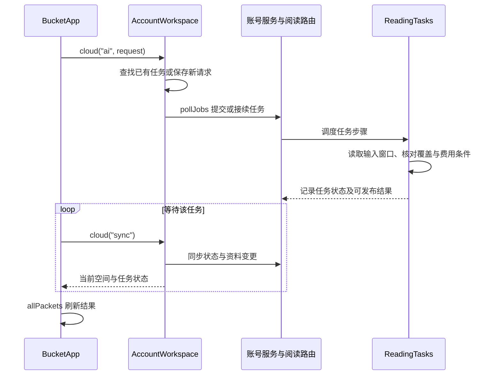

# 拾序项目交接

代码基线 `6c01cd8`，包版本 `0.3.33`。本页行号对应这份源码。接手先读 [AGENTS.md](AGENTS.md)、[贡献流程](CONTRIBUTING.md) 和[固定开发位置](docs/project-continuity/local-workspace.md)，核对 Git 状态、远端主线及未收尾 PR。部署、安装和微信审核状态需分别查证。[当前基线](docs/current-baseline.md) · [历史归档](docs/archive/README.md) · [更新日志](CHANGELOG.md)

## 1. 项目定位与核心功能

拾序把个人的通知、想法和附件收进「桶」，整理成能在「世界」、截止日期视图和桌面看板中持续维护的事项。

- **收集与整理**。投递文本或附件、保存草稿和原文、提取来源、创建事项及围绕事项对话。入口在 `src/bucket/BucketApp.tsx`，附件处理在 `src/bucket/ingest.ts`，整理与对话分别在 `shared/bucket-engine.mjs`、`src/bucket/item-chat.ts`。
- **事项管理**。「世界」支持检索、分组、排序、完成、回收与恢复。DDL 解析日期、时刻和区间，展示推定结果。入口在 `src/bucket/Results.tsx`、`src/bucket/DDL.tsx`、`shared/deadlines.mjs`。
- **Windows 看板与本机资料**。规划、短期和长期事项、独立资料库与悬浮窗口由 `src/board/BoardApp.tsx`、`desktop/board-window.cjs` 接入；资料存储、备份和软件更新分别见 `desktop/storage.cjs`、`desktop/backup.cjs`、`desktop/update.cjs`。
- **微信与账号同步**。微信原生页面支持本机投递、原件和账号空间；连接同一账号后可同步卡片和查看服务端任务。入口在 `miniprogram/pages/index/index.js`、`miniprogram/lib/local-workspace.js`、`miniprogram/lib/sync-client.js`。本机投递通过显式导入进入账号空间。见[小程序指南](miniprogram/README.md)。
- **服务端阅读与管理**。独立服务处理账号和设备、原件、限额与费用、阅读任务和恢复。管理台提供用户、任务、备份、告警及运维视图。见 `server/sync-multi-user.mjs`、`server/reading/tasks.mjs`、`server/reading/ledger.mjs`、`src/admin/AdminApp.tsx`、`server/admin-backend.mjs`。

## 2. 目录结构与模块地图

| 类别 | 路径 | 维护职责 |
| --- | --- | --- |
| 【核心入口文件】网页及 Electron 渲染器 | `index.html` → `src/main.tsx` | 默认加载 `src/bucket/BucketApp.tsx`。查询参数 `board=1` 优先进入看板，`legacy=1` 进入 `src/LegacyApp.tsx`。 |
| 【核心入口文件】Windows 主进程 | `desktop/main.cjs`、`desktop/preload.cjs`、`src/desktop.d.ts` | 主进程加载应用并注册 IPC；预加载脚本限定渲染器可调用的方法，TS 声明描述桥接接口。账号空间在 `desktop/accounts.cjs`。 |
| 数据与共享规则 | `src/bucket/types.ts`、`src/bucket/store.ts`、`shared/relations.mjs`、`shared/usage.mjs`、`shared/board.mjs` | 分别定义投递与事项状态、选择本机存储适配器、计算关联、用量和看板规则。共享模块的 TS 声明与实现并排，例如 `shared/board.d.mts`。 |
| 【核心入口文件】小程序 | `miniprogram/app.js`、`miniprogram/app.json`、`miniprogram/pages/index/index.js`、`miniprogram/pages/index/index.wxml` | 应用入口、页面注册、交互及模板。网络和原件处理在 `miniprogram/lib/transport.js`、`miniprogram/lib/originals.js`。 |
| 【核心入口文件】服务 | `server/index.mjs`、`server/sync-server.mjs`、`server/sync-multi-user.mjs`、`server/reading-runtime.mjs` | 分别为个人网页服务、v2 单空间同步、v3 多账号、v4 阅读运行时。v4 装配账号服务、阅读代理客户端和独立账本。 |
| 阅读与同步内部模块 | `server/sync-store.mjs`、`server/originals.mjs`、`server/reading/routes.mjs`、`server/reading/scheduler.mjs`、`server/reading/tasks.mjs`、`server/reading/broker-service.mjs` | 分管同步记录、原件、阅读接口、账号间调度、任务步骤、隔离读取代理。模型调用及账本分别在 `server/reading/deepseek.mjs` 和 `server/reading/ledger.mjs`。 |
| 【核心入口文件】管理台与应急网页 | `admin/index.html` → `src/admin/main.tsx`；`admin-test/index.html`、`src/bucket/edition.ts` | 前者是管理控制台。后者复用投递界面，使用独立浏览器数据空间。管理端 HTTP 服务与本机网关分别在 `server/admin-service.mjs`、`server/console-gateway.mjs`。 |
| 旧版、官网、部署 | `supabase/schema.sql`、`src/LegacyApp.tsx`；`website/public/index.html`；`deploy/sync/`、`deploy/windows/`、`deploy/website/` | 旧版资料入口、静态官网和三个不同交付面。账号服务部署见 `deploy/sync/README.md`，Windows 管理台启动见 `deploy/windows/Launch-Console.ps1`。 |
| 【配置文件】工具链 | `package.json`、`package-lock.json`、`vite.config.ts`、`tsconfig.json`、`miniprogram/project.config.json`、`playwright.config.ts`、`.github/workflows/ci.yml` | npm 命令与 Electron 打包规则、依赖锁、Vite 三个 HTML 入口、TS 严格模式、微信工程、浏览器自动化和 PR 门禁。 |
| 开发索引与素材 | `scripts/`、`e2e/`、`test-fixtures/`、`public/`、`design/README.md`、`THIRD_PARTY_NOTICES.md` | 构建维护工具、端到端场景、夹具、产品运行资源、视觉约定及第三方许可。 |

**【禁止手动修改的自动生成文件/目录】**

| 产物 | 修改来源与再生成入口 |
| --- | --- |
| `miniprogram/lib/generated/`、`miniprogram/pages/index/index.wxss`、`server/generated/ai-core.mjs`、`desktop/generated/` | 编辑 `shared/`、相应桌面源码或微信传输源码后运行 `npm run mini:build`。页面样式来源包括 `src/bucket/mini-page.wxss`、`miniprogram/pages/index/cards.wxss`、`miniprogram/pages/index/card-visuals.wxss`。完整输入输出及哪些图片/音频会被复制见 `scripts/build-miniprogram.mjs`。 |
| `server/reading/generated-native/`、`server/reading/generated-webp/`、`server/reading/generated-pdf-visual/` | 分别由 `scripts/build-reading-archive.mjs`、`scripts/build-reading-webp.mjs`、`scripts/build-reading-pdf-visual.mjs` 按平台生成。 |
| `dist/`、`release/` | 构建输出。网页离线壳和版本信息由 `scripts/build-sw.mjs` 写入，Windows 安装器由 `package.json` 的 electron-builder 配置写入。 |

## 3. 核心架构与数据流

**链路一：保存一条投递。** 默认界面的提交先持久化投递，再清空输入和草稿。浏览器和桌面走同一个前端存储接口。桌面通过 IPC 切换到当前空间，界面不直接打开桌面资料文件。

源码定位：`src/bucket/BucketApp.tsx` 的 `submit` 和 `saveMany`、`src/bucket/store.ts` 的 `putPackets`、`desktop/preload.cjs`、`desktop/main.cjs` 的 `store` 处理器、`desktop/accounts.cjs` 与 `desktop/storage.cjs`。

**链路二：已接通 v4 的 Windows 账号整理一条投递。** 本地任务记录先保存，随后经同步提交或接续。服务端负责读取材料、判断能否派发模型调用、记录覆盖与费用。客户端按任务 ID 读回进度；部分完成、暂停、空间切换和超时各有独立分支。

客户端见 `src/bucket/BucketApp.tsx` 的 `runCloudAI`、`desktop/accounts.cjs` 的 `createAI`；服务端装配与执行见 `server/reading-runtime.mjs`、`server/sync-multi-user.mjs`、`server/reading/routes.mjs`、`server/reading/tasks.mjs`。价格过期仍可启动同步服务，付费请求前仍需通过价格核验，见 `server/reading-runtime.mjs` 的 `priceAt`。

## 4. 环境与常用命令

在含 `package.json` 的仓库根目录执行命令。本机登记的日常开发目录是工作区下的 `shixu-governance/`。环境为 **Node.js 24.x、npm、Git**；桌面运行使用 Windows，发行目标为 Windows x64 NSIS。微信工程用官方微信开发者工具导入 `miniprogram/`。项目未在 `package.json` 固定 npm 小版本。[开发指南](docs/guides/development.md)

| 目的 | 命令与产物 |
| --- | --- |
| 安装、开发、预览 | `npm ci`；`npm run dev` 启动 Vite，默认 5173；`npm run build` 生成网页和离线壳后，`npm run preview` 在 4173 预览。 |
| 静态检查 | `npm run check` 执行 TypeScript 检查；`node scripts/check-docs.mjs` 核对文档链接；`npm run site:check` 检查官网。 |
| Windows 开发与打包 | `npm run desktop:build` 生成桌面前端；`npm run desktop:start` 自带构建步骤并启动 Electron；`npm run desktop:pack` 构建 x64 安装器至 `release/`。 |
| 微信共享资源 | `npm run mini:build` 生成；`npm run mini:check` 比对；`npm run mini:compile` 用官方编译器检查，须将 `WECHAT_COMPILER_DIR` 指向含 wcc、wcsc 的目录。 |
| 后端入口（按场景选一个） | `npm start` 个人服务，默认 8787；`npm run sync:start`、`npm run sync:accounts`、`npm run sync:reading` 分别启动 v2、v3、v4，均默认 8788；`npm run admin:start` 启动独立管理服务，默认 8789。v4 可集成管理服务，注意端口占用。 |
| 原生阅读产物 | `npm run reading:archive:build`、`npm run reading:webp:build`、`npm run reading:pdf:visual:build`。所需平台、工具、源包和校验值见第 2 节相应构建脚本。 |

**按入口配置环境。** 网页本地开发和桌面本机录入无需服务密钥。模板只有变量名及示例；服务脚本用 `--env-file-if-exists` 加载相应文件。以下仅列变量名、约束和非敏感默认值。

| 配置来源 | 启动条件与可选项 |
| --- | --- |
| 个人服务 `.env.example` → `.env`；`server/index.mjs` | 回环启动有默认值。非回环绑定必须提供 HTTPS 的 `APP_ORIGIN` 和至少 12 字符的 `APP_PASSWORD`。可选 `HOST`、`PORT`、`DATA_DIR`；模型可通过连接面板设置密钥，或使用 `DEEPSEEK_API_KEY`、`DEEPSEEK_MODEL`。 |
| v2，同步模板 `.env.sync.example` → `.env.sync`；`server/sync-server.mjs` | 必需 `SYNC_PASSWORD`，至少 12 字符。可选 `SYNC_HOST`、`SYNC_PORT`、`SYNC_DATA_DIR`、`SYNC_ORIGIN`，非回环需 HTTPS 来源。启用服务端模型需 `SYNC_AI_ENABLED=true` 和 `DEEPSEEK_API_KEY`。 |
| v3，同一环境文件；`server/sync-multi-user.mjs`、`server/sync-accounts.mjs` | 必需 `SYNC_ACCOUNT_SECRET`，至少 32 字符。可设 `SYNC_ACCOUNT_DIR`、`SYNC_PORT`、`SYNC_ORIGIN`。微信身份接入用 `WECHAT_APP_ID` 与 `WECHAT_APP_SECRET`。启用 AI 时核对开关、密钥及 `SYNC_AI_TASK_BUDGET_MICROS`、`SYNC_AI_DAILY_BUDGET_MICROS`，两个预算默认均为 0。 |
| v4，同一环境文件；`server/reading-runtime.mjs` | 必需 `SYNC_ACCOUNT_SECRET` 和指向 JSON 的绝对路径 `SYNC_V4_CONFIG`。配置包含资料目录、独立账本路径、读取代理 socket、`enabled`、`pdfVisual` 和 tariff；资料与账本目录须按入口校验隔离。启用模型需 `DEEPSEEK_API_KEY`；配置 `SHIXU_AUTHORITY_FLOOR` 时也须为绝对路径。集成管理台用 `SHIXU_ADMIN_STATE` 及下行身份变量。 |
| 管理台 `.env.admin.example` → `.env.admin`；`server/admin-service.mjs` | 必需 `SHIXU_ADMIN_USERNAME` 和按该模块 `hashAdminPassword` 生成的 `SHIXU_ADMIN_PASSWORD_HASH`。可设 `SHIXU_ADMIN_PORT`、`SHIXU_ADMIN_ORIGIN`；来源需与实际浏览器入口匹配。提供静态界面前先构建 `dist/`。 |
| 浏览器构建选项；`vite.config.ts`、`src/admin/api/index.ts` | `VITE_BASE_PATH` 调整资源前缀。管理台默认合成数据，`VITE_ADMIN_API=http` 或查询参数 `?api=http` 选择 HTTP 适配器。所有 `VITE_` 值均按公开配置处理。 |

## 5. 代码规范与开发约定

- **遵循所在模块的语言与命名。** React 组件采用 PascalCase，Hook 用 `use` 前缀，例如 `src/bucket/ItemDialog.tsx`、`src/bucket/useCardDrag.ts`。前端启用严格 TS，共享与服务模块多用 ESM `.mjs`，Electron 主进程与预加载使用 `.cjs`。格式依据 `.editorconfig`：UTF-8、通常 LF、两空格缩进。避免顺手重排历史文件。
- **分清视图状态和持久状态。** React 本地状态管理选择、筛选和提示，`src/bucket/store.ts` 处理资料写入与附件编码。`src/bucket/BucketApp.tsx` 的提交锁、防重复确认及清草稿顺序，`src/bucket/Results.tsx` 的变更队列和完成锁，都应在提取函数时保留。
- **保留协议错误语义。** 服务使用明确的错误码和状态，见 `server/sync-store.mjs`、`server/reading/tasks.mjs`；界面提示转换见 `src/bucket/error-message.ts`。继续、取消、超时与部分完成具有不同恢复语义。日期推定使用保存的录入日，规则见 `shared/deadline-date.mjs`、`shared/deadline-time.mjs`。
- **按实际交付面提交。** 查看当前分支与 PR；新任务在固定目录从最新 `origin/main` 建专用分支并运行 `npm run workspace:check -- --start`，继续任务用 `npm run workspace:check`。显式暂存、Conventional Commit、推送任务分支并走 PR。涉及产品模块须更新 [双端能力表](docs/client-parity.md)，生成物随源提交。合并、构建、安装和真机验收分别记录。详见 [AGENTS.md](AGENTS.md) 和 [CONTRIBUTING.md](CONTRIBUTING.md)。

## 6. 已知技术债与避坑清单

**待确认的三项边界风险。** 以下是源码分析与修复方案，尚未实施。原始排查和两批变更见[问题与重构清单](docs/project-continuity/readability-audit-20261128.md)。

| 当前位置 | 风险 | 最小修复方向与代价 |
| --- | --- | --- |
| `scripts/build-console-release.mjs:126`、`scripts/build-console-release.mjs:147` | 发行目录已有安装清单时跳过写入，最终只解析其来源字段。清单语法有效但文件表损坏，仍可能给出成功回执。 | 复用前比对应用、运行时、指纹、完整文件表、大小及摘要，校验来源提交格式。相同字节沿用首次来源。中风险，旧清单缺字段可能需要重建。 |
| `scripts/build-cloud-release.mjs:48`、`scripts/build-cloud-release.mjs:53` | 先写 release.json，再写 SHA256SUMS，中断时目标目录可能只有一半更新。 | 在同文件系统临时目录生成并校验全包，再一次重命名发布。保留拒绝覆盖和同目标并发保护。中风险，需考虑中断重试、残留临时目录及 Windows 行为。 |
| `miniprogram/pages/index/index.js:3263`、`miniprogram/pages/index/index.js:3268` | stop 抛错后仍会收起动画，底层声音可能继续播放。 | 仅在异常分支解除旧实例引用、清空缓存、尽力 destroy，维持单次动画收尾。低至中风险，destroy 也可能失败；需真机核对切换、连点和卸载。 |

**四项 Electron 间接弃用依赖。** 以下均属于 electron-builder → app-builder-lib 的构建依赖树，锁版本保持现状。迁移成本为估计。

| 位置与锁定版本 | 引入路径及迁移建议 |
| --- | --- |
| `package-lock.json:2799` · boolean 3.2.0 | @electron/get → global-agent 直接使用，roarr 也使用。随下载器/代理链迁出，核对代理与日志环境变量的字符串布尔语义。成本中。 |
| `package-lock.json:4012` · glob 7.2.3 | @electron/asar 与 temp → rimraf 都引入。两条父包链一起迁移，核对 Windows 通配符、排除项及 ASAR 文件清单。成本中至高。 |
| `package-lock.json:4310` · inflight 1.0.6 | 两条 glob 7 路径共享。随旧 glob 退出后核对依赖树，通常无需业务代码替换。增量成本低。 |
| `package-lock.json:5407` · rimraf 2.6.3 | electron-builder-squirrel-windows → electron-winstaller → temp。随父包改用受维护的清理实现，核对 Windows 文件占用、重试与安装器临时目录清理。成本中。 |

**维护时容易误删或误判的逻辑**

- **归档构建器改动会触发一次重建。** `scripts/build-reading-archive.mjs:222` 对构建脚本本身求哈希，`scripts/build-reading-archive.mjs:231` 以它判断缓存命中。上批移除未使用导入也改变了摘要；下次调用时旧缓存会失效。保留校验，让正常构建生成新清单。
- **旧事项 ID 与附件形态仍可读。** `src/bucket/Results.tsx:70` 给缺少稳定 ID 的旧数据回退到投递 ID 加索引；`src/bucket/store.ts:12` 记录 WebKit 写入字节和读取旧 Blob 的兼容原因。变更排序、关联或存储时需照顾已有资料。
- **固定历史夹具必须独立。** `scripts/stage-a/legacy/README.md:3` 记录固定来源与摘要，`scripts/stage-a/legacy/sync-files.mjs:38` 和 `server/sync-files.mjs:38` 即使实现相同也不能联动更新。
- **长函数仍需按职责渐进拆分。** `src/bucket/BucketApp.tsx:176` 拥有投递状态和副作用，`src/bucket/Results.tsx:121` 拥有卡片交互，`server/reading/tasks.mjs:1120` 编排读取与任务恢复。第二批已提取附件筛选、行构造和窗口读取；继续拆分时应保留 React Hook 调用顺序、任务持久化时点与费用状态。

维护参考：[桌面产品计划](docs/desktop-product-plan.md) · [桌面实现](docs/desktop-implementation.md) · [Windows 发行记录](https://github.com/HYX-2024-1020/shixu/releases/latest) · [0.3.31 历史发行说明](docs/releases/windows-0.3.31.md) · [拾序官网](https://www.shixunote.top/)
