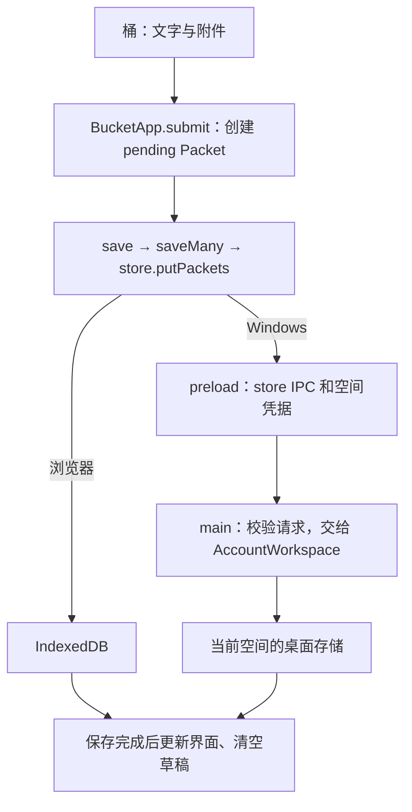
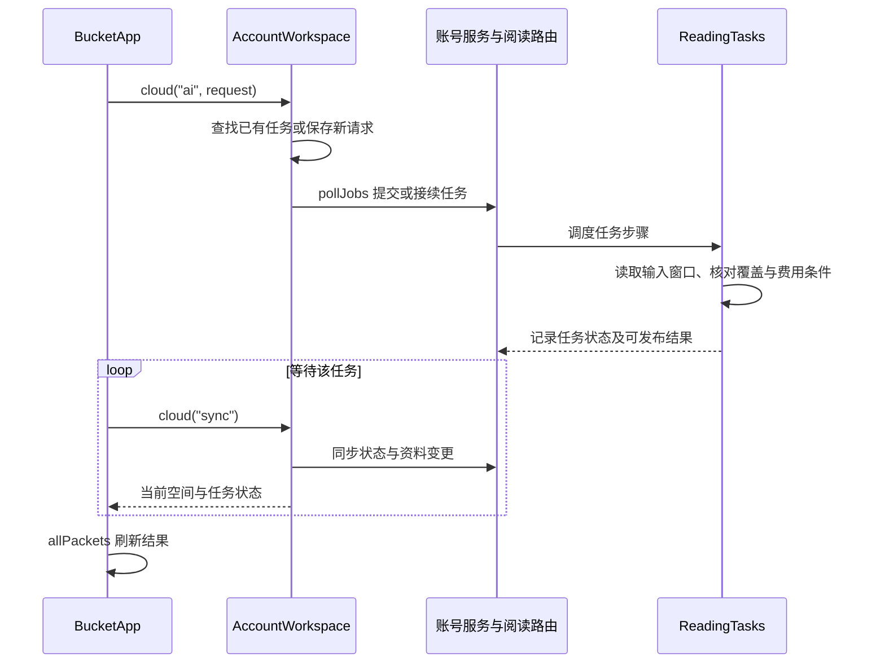

# 拾序项目交接

包版本 `0.3.33`。接手先看当前 Git 分支、远端 `origin/main` 及开放 Issue/PR，再结合 [AGENTS.md](AGENTS.md) 和 [贡献流程](CONTRIBUTING.md) 推进。部署、本机安装与微信审核状态需分别查证。[当前基线](docs/current-baseline.md) · [文档导航](docs/README.md) · [历史归档](docs/archive/README.md) · [更新日志](CHANGELOG.md)

## 1. 项目定位与核心功能

拾序把个人的通知、想法和附件收进「桶」，整理成能在「世界」、截止日期视图和桌面看板中持续维护的事项。

- **收集与整理**：投递文本或附件、保存草稿和原文、提取来源、创建事项及围绕事项对话。入口在 `src/bucket/BucketApp.tsx`，附件处理在 `src/bucket/ingest.ts` 与 `src/bucket/files.ts`，整理与对话分别在 `shared/bucket-engine.mjs`、`src/bucket/item-chat.ts`。
- **事项管理**：「世界」支持检索、分组、排序、完成、回收与恢复；DDL 解析日期、时刻和区间并展示推定结果。入口在 `src/bucket/Results.tsx`、`src/bucket/DDL.tsx`、`shared/deadlines.mjs`。
- **Windows 看板与本机资料**：规划、短期/长期事项、独立资料库与悬浮窗口由 `src/board/BoardApp.tsx`、`desktop/board-window.cjs` 接入；资料存储、备份和软件更新见 `desktop/storage.cjs`、`desktop/backup.cjs`、`desktop/update.cjs`。
- **微信与账号同步**：微信原生页面支持本机投递、原件与账号空间，连接同一账号可同步卡片与查看服务端任务。入口在 `miniprogram/pages/index/index.js`、`miniprogram/lib/local-workspace.js`、`miniprogram/lib/sync-client.js`。详见 [小程序指南](miniprogram/README.md)。
- **服务端阅读与管理**：独立服务处理账号设备、原件、限额与费用、阅读任务和恢复；管理台提供用户、任务、备份、告警及运维视图。见 `server/sync-multi-user.mjs`、`server/reading/tasks.mjs`、`server/reading/ledger.mjs`、`src/admin/AdminApp.tsx`、`server/admin-backend.mjs`。

## 2. 目录结构与模块地图

| 类别 | 路径 | 维护职责 |
| --- | --- | --- |
| 网页及 Electron 渲染器 | `index.html` → `src/main.tsx` | 默认加载 `src/bucket/BucketApp.tsx`；`?board=1` 进看板 `src/board/BoardApp.tsx`。 |
| Windows 主进程 | `desktop/main.cjs`、`desktop/preload.cjs`、`src/desktop.d.ts` | 主进程加载应用并注册 IPC；预加载限定渲染器桥接接口；账号空间在 `desktop/accounts.cjs`。 |
| 数据与共享规则 | `src/bucket/types.ts`、`src/bucket/store.ts`、`shared/{relations,usage,board,deadlines}.mjs` | 定义投递与事项状态、本机存储适配器、关联/用量/看板/日期规则；共享 `.mjs` 配同名 `.d.mts`。 |
| 微信小程序 | `miniprogram/app.js`、`miniprogram/app.json`、`miniprogram/pages/index/index.{js,wxml}` | 入口、页面注册、交互与模板；网络与原件在 `miniprogram/lib/{transport,originals}.js`。 |
| 服务端 | `server/{index,sync-server,sync-multi-user,reading-runtime}.mjs` | 分别为个人服务、v2 单空间、v3 多账号、v4 阅读运行时（装配账号服务、隔离代理与独立账本）。 |
| 阅读与同步内部 | `server/sync-store.mjs`、`server/originals.mjs`、`server/reading/{routes,scheduler,tasks,broker-service,deepseek,ledger}.mjs` | 分管同步记录、原件、阅读接口、调度、任务步骤、隔离读取代理、模型调用与独立账本。 |
| 管理台与应急网页 | `admin/index.html` → `src/admin/main.tsx`；`admin-test/index.html`、`src/bucket/edition.ts` | 管理控制台（HTTP 服务 `server/admin-service.mjs`、本机网关 `server/console-gateway.mjs`）与独立空间应急网页。 |
| 官网与部署 | `website/public/index.html`；`deploy/{sync,windows,website}/` | 静态官网、服务端部署、Windows 管理台启动与对应发布回归测试。 |
| 工程脚本（已分层） | `scripts/{build,check,desktop,ops,reading,stage-a}/` | 分别负责构建打包、CI 门禁校验、Windows 桌面冒烟、云端运维、阅读测试夹具与阶段 A 演练。 |
| 工具链配置 | `package.json`、`vite.config.ts`、`tsconfig.json`、`miniprogram/project.config.json`、`playwright.config.ts`、`.github/workflows/ci.yml` | npm 脚本、Electron 打包、三入口构建、TS 严格模式、微信工程、E2E 与 CI 门禁。 |

**禁止手动修改的自动生成产物**

| 产物 | 修改来源与再生成命令 |
| --- | --- |
| `miniprogram/lib/generated/`、`miniprogram/pages/index/index.wxss`、`server/generated/ai-core.mjs`、`desktop/generated/` | 修改 `shared/`、对应桌面或微信样式源后运行 `npm run mini:build` 并随源提交，通过 `npm run mini:check`（完整映射见 `scripts/build/build-miniprogram.mjs`）。 |
| `server/reading/generated-native/`、`generated-webp/`、`generated-pdf-visual/` | 分别运行 `npm run reading:archive:build`、`reading:webp:build`、`reading:pdf:visual:build` 生成。 |
| `dist/`、`release/` | 构建输出目录，禁止手改，不提交进 Git。 |

## 3. 核心架构与数据流

**链路一：保存一条投递。** 提交先持久化再清输入与草稿；桌面端渲染器经 `desktop/preload.cjs` IPC 交主进程校验后由 `AccountWorkspace` 写入当前空间，不直接打开桌面资料文件。

**链路二：v4 云端账号整理。** 本地先保存任务请求，经同步提交/接续 `ReadingTasks`，服务端按窗口读取、校验覆盖与费用/计价有效期（价格过期仍允许同步与管理服务启动，但付费请求前强制校验 `priceAt`），客户端轮询同步回写并刷新。

## 4. 环境、常用命令与配置

在主仓库 `shixu/` 执行命令，需要 **Node.js 24.x、npm、Git**（Windows PowerShell 5 默认禁 `.ps1` 时使用 `npm.cmd` 或 `node`）。[开发指南](docs/guides/development.md)

| 目的 | 命令 |
| --- | --- |
| 开发与预览 | `npm ci`、`npm run dev`（5173）、`npm run build`、`npm run preview`（4173） |
| 静态与门禁 | `npm run check`、`npm run mini:check`、`node scripts/build/build-reading-parser.mjs --check`、`node scripts/check/check-docs.mjs`、`npm run site:check` |
| 核心测试 | `npm test`、`npm run test:server`、`npm run test:sync`、`npm run test:sync:release`、`npm run test:desktop`、`node --test deploy/windows/*.test.mjs`、`npm run test:e2e` |
| 桌面与打包 | `npm run desktop:build`、`npm run desktop:start`、`npm run desktop:pack`、`npm run test:desktop:ui` |
| 微信构建 | `npm run mini:build`、`npm run mini:check`、`npm run mini:compile`（需 `WECHAT_COMPILER_DIR`） |
| 后端启动 | `npm start`（8787 个人）、`sync:start`/`sync:accounts`/`sync:reading`（8788 v2/v3/v4）、`admin:start`（8789 管理台） |

**环境文件约束**：网页与桌面本机开发无需密钥；服务通过 `--env-file-if-exists` 读取对应 `.env*`（仅模板入库）。非回环绑定必须配置 HTTPS 来源与合规口令/密钥；v4 需绝对路径 `SYNC_V4_CONFIG` 且资料与账本目录隔离；所有 `VITE_*` 变量均为公开构建配置。

## 5. 代码规范与核心约定

- **语言与格式**：前端严格 TS（组件 `PascalCase`、Hook `use*`）；共享与服务端用 ESM `.mjs`，Electron 主进程/预加载用 `.cjs`；遵循 `.editorconfig`（UTF-8、LF、2 空格），不顺手重排历史文件。
- **状态与错误语义**：分清 React 视图状态与 `src/bucket/store.ts` 持久状态；保留 `server/sync-store.mjs`、`server/reading/tasks.mjs` 与 `src/bucket/error-message.ts` 的错误码与恢复语义；DDL 推定必须以保存的录入日为基准（`shared/deadline-date.mjs`、`shared/deadline-time.mjs`）。
- **CI 硬门禁**：专用任务分支 + Conventional Commits + PR 四节 + 产品源码改动同步更新 [双端能力表](docs/client-parity.md) + Gitleaks 全历史扫描。详见 [AGENTS.md](AGENTS.md) 与 [CONTRIBUTING.md](CONTRIBUTING.md)。

## 6. 架构债与避坑清单

**持续关注的结构热点**

- **超大单文件待渐进拆解**：`miniprogram/pages/index/index.js`（~3,570 行）、`src/bucket/BucketApp.tsx`（~2,450 行）、`src/bucket/Results.tsx`（~2,125 行）、`server/reading/tasks.mjs`（~1,885 行）。继续拆分时必须保持 React Hook 顺序、提交锁/防重复确认/清草稿时序、变更队列/完成锁及任务持久化与费用结算时点。

**四项 Electron 间接弃用依赖**（均来自 `electron-builder` → `app-builder-lib`，保持锁版本，升级须验证 Windows 通配符、临时清理与 ASAR 清单）：`boolean@3.2.0`、`glob@7.2.3`、`inflight@1.0.6`、`rimraf@2.6.3`。

**维护时切勿误删或误判的逻辑**

- **归档构建器自哈希**：`scripts/build/build-reading-archive.mjs` 以脚本自身哈希判断缓存命中，修改脚本会正常触发一次工具重建，勿手改缓存凭据。
- **旧数据向后兼容**：`src/bucket/Results.tsx` 为缺少稳定 ID 的旧事项保留 `packetId:index` 回退；`src/bucket/store.ts` 保留 WebKit 写字节 / 读旧 Blob 兼容。
- **历史夹具独立不可联动**：`scripts/stage-a/legacy/sync-files.mjs` 与 `server/sync-files.mjs` 实现相同但前者是固定对照基线，切勿联动修改。

维护参考：[桌面产品计划](docs/desktop-product-plan.md) · [桌面实现](docs/desktop-implementation.md) · [Windows 发行记录](https://github.com/HYX-2024-1020/shixu/releases/latest) · [0.3.33 发行说明](docs/releases/windows-0.3.33.md) · [拾序官网](https://www.shixunote.top/)
