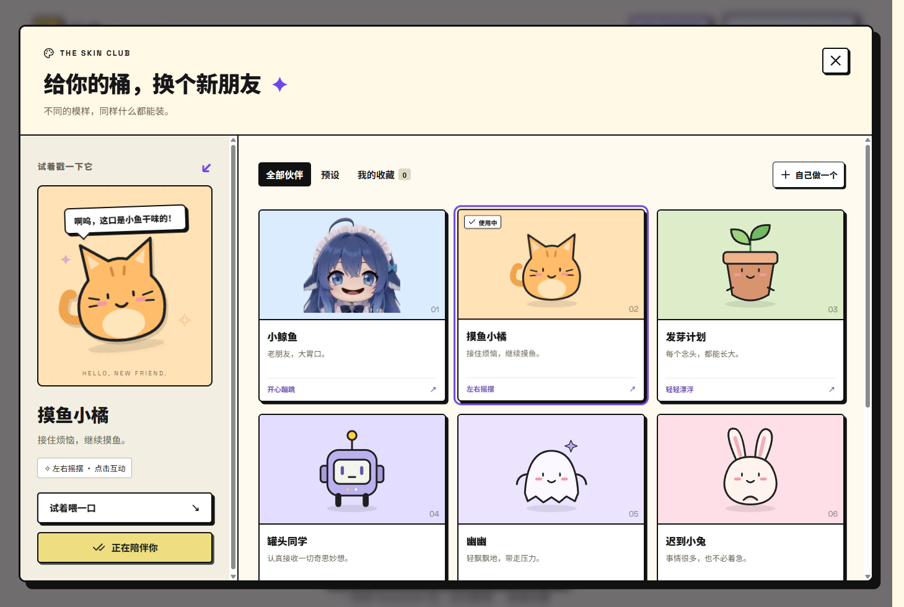

# 拾序 Shixu

[管理员测试版（iPhone 应急直连）](https://hyx-2024-1020.github.io/shixu/admin-test/) · [使用说明](docs/guides/admin-test.md)

**一个，什么都能放的桶。**

把通知、截图、附件和零散想法放进同一个输入框。拾序通过AI整理成可编辑的事项卡片，保留原文和附件：在「桶」里接住内容，在「世界」里管理后续，在「DDL」里查看截止事项。当前账号版由服务端统一调用DeepSeek，无需填写个人模型密钥。

**[下载 Windows 最新版](https://github.com/HYX-2024-1020/shixu/releases/latest) · [打开网页版](https://hyx-2024-1020.github.io/shixu/) · [使用指南](docs/guides/windows.md) · [开发与贡献](CONTRIBUTING.md)**

## 先用起来

2026-11-14：用户暂停下述0.3.27验收后，基础可靠性及本轮体验问题已集中修复。**0.3.28** 产品包来源08d38fa，原阿里云已原位更新并完成合成资料闭环，无新增模型调用；验证头7396c70六项必需CI成功。Windows/原管理台联合更新器已准备，用户本人安装及物理核验仍待，原安装仍为0.3.27/f8771df。[实际状态与验证](docs/project-continuity/acceptance-stability-20261114.md) · [更新与接续验收](docs/guides/product-acceptance-0.3.28.md)。不以源码版本、API成功或入口可打开代替用户体验。

第二轮 **0.3.27** 已完成代码整改、适用回归、原阿里云部署和Windows/原管理台原生联合更新；用户确认原两个入口打开，无包身份只读核验物理文件、44个受管文件及运行指纹通过。必需CI、真实合成服务/模型、运行包来源与诚实遗留见[实施与验证记录](docs/project-continuity/acceptance-round2-repair-20261113.md)，集中体验见[0.3.27指南](docs/guides/product-acceptance-0.3.27.md)；安装及入口确认不等于用户功能总体验收。

上一轮实际运行 **0.3.26** 已完成代码整改、适用回归、原阿里云服务部署及Windows/原本地控制台实际安装。用户确认原两个入口打开，物理回执、43个受管文件、客户端及控制台运行版本已核验；最后交付记录仍按PR最新头完成必需CI与收尾。实际版本、C01—C28对照、真实服务证据及已知问题见[逐项整改记录](docs/project-continuity/acceptance-repair-20261112.md)，普通复验见[0.3.26指南](docs/guides/product-acceptance-0.3.26.md)。部署、用户安装和用户验收分别核对。

此前0.3.24建立受保护私有连接和原管理台入口，见[历史记录](docs/releases/windows-0.3.24.md)；上一用户安装基线为[0.3.25](docs/project-continuity/product-0.3.25-delivery.md)。继续保留卡片、DDL、皮肤、音画及#106任务名额修复。账号版未激活仍可本地记录。公开 Release 当前仍为 **0.3.8**，本轮受控交付不等同于公开发布。

以下步骤针对公开的旧版 0.3.8；0.3.23 本机账号版以交付记录为准。

1. 在 [Releases](https://github.com/HYX-2024-1020/shixu/releases/latest) 下载 **Shixu-Setup-0.3.8.exe**；同页提供 SHA-256 和验证报告。
2. 安装并打开「拾序」。升级前从托盘正常退出旧版；关闭窗口会收进托盘。
3. 在「连接与设置」填写自己的 DeepSeek API 密钥，再输入或拖入材料，点「丢进去」。
4. 本次结果留在桶里，全部事项在「世界」里管理。右上角「皮肤市场」可以换伙伴。

普通使用无需 Node.js、终端或开发服务器。AI 整理需要联网并消耗你自己的 API 额度；离线时可以先保存输入。请勿将密钥或真实个人材料贴到公开 Issue。

## 现在能做什么

- **一起投递**：文字、图片、PDF、Office 与代码；Windows 还能读取 ZIP / RAR / 7z。
- **保留依据**：区分原文要求、AI 总结和建议，直接预览同次投递的图片、PDF 和提取文字。
- **管理事项**：编辑、星标、完成、分组、搜索、最近删除；卡片原位开合、长按排序。
- **对话修改**：针对当前卡片与 AI 多轮交流，保存修改和对话记录。
- **换个伙伴**：8 款预设皮肤、自定义图片与台词，桶和世界一致换肤。
- **本地保存**：Windows 独立资料目录、系统加密密钥、含原件的资料备份与恢复。



截图来自实际桌面构建，使用合成测试资料。更多操作见 [Windows 指南](docs/guides/windows.md)。

## 选择你的入口

| 入口                                                                     | 当前状态             | 适合做什么                                                        |
| ------------------------------------------------------------------------ | -------------------- | ----------------------------------------------------------------- |
| [Windows 安装包](https://github.com/HYX-2024-1020/shixu/releases/latest) | 正式发行 0.3.8       | 日常使用；完整桌面文件处理、备份、皮肤市场                        |
| [网页版](https://hyx-2024-1020.github.io/shixu/)                         | 当前 main 的在线构建 | 免安装体验；数据留在当前浏览器，见 [网页指南](docs/guides/web.md) |
| [微信小程序](miniprogram/README.md)                                      | 原生开发工程         | 开发者工具接续；尚未真机验收或公开发布                            |
| [独立同步服务](deploy/sync/README.md)                                    | 受控v3账号服务       | 已有双端账号/原件/任务接入；公网、手机与B/C/D另验                 |

Windows与微信源码已有账号同步接入；正式网络和客户端可用性须按[当前基线](docs/current-baseline.md)及部署/交付记录核对，不宣称已完成手机公网验收。普通网页与应急测试版仍是各自浏览器本地资料，不自动跨设备同步。 皮肤收藏仅保存在本机，暂不包含在事项备份中。模型可能识别或总结错误，重要要求请核对原文；各平台的格式支持和限制见各自指南。

## 开发

需要 **Node.js 24.x**、npm；桌面运行和桌面 UI 验证需要 Windows。

```bash
npm ci
npm run dev             # 网页开发
npm run desktop:start   # Windows 桌面开发
```

[开发指南](docs/guides/development.md)说明目录、验证与打包；[架构说明](docs/architecture.md)区分桌面、网页、旧资料兼容和同步服务。贡献遵循 **Issue → 任务分支 → 验证 → PR**，详见 [CONTRIBUTING.md](CONTRIBUTING.md)；代理另须读取 [AGENTS.md](AGENTS.md)。

## 文档与反馈

- [文档目录](docs/README.md) · [当前进度与路线](docs/current-baseline.md) · [版本记录](CHANGELOG.md)
- [反馈问题](https://github.com/HYX-2024-1020/shixu/issues/new/choose) · [私密报告安全问题](SECURITY.md)
- [隐私与数据](PRIVACY.md) · [社区行为准则](CODE_OF_CONDUCT.md)

代码采用 [MIT](LICENSE)。第三方依赖、字体、图像与音频保留各自许可；既有角色图像和笑声的授权记录仍待补齐，见 [第三方声明](THIRD_PARTY_NOTICES.md)。
