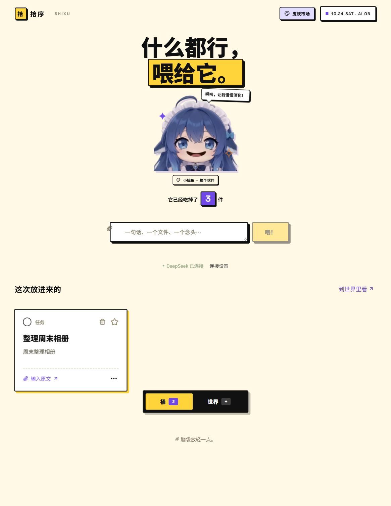

# Windows 使用指南

## 安装与升级

从 [最新 Release](https://github.com/HYX-2024-1020/shixu/releases/latest) 下载 Windows x64 安装器。当前版本为 **0.3.8**，文件名 `Shixu-Setup-0.3.8.exe`；`SHA256SUMS.txt` 可用于检查下载完整性。

安装后打开「拾序」即可使用，不需要 Node.js 或浏览器。关窗会收进托盘；从托盘菜单选择「退出拾序」才会退出。覆盖升级前正常退出旧版，沿用现有安装目录，并建议先在设置中备份资料。

## 投递与整理

在「连接与设置」填写自己的 DeepSeek API 密钥。文字整理使用所选模型，图片和扫描页使用 DeepSeek Flash。API 调用会产生费用，实际扣款以服务商账单为准。

把相关文字、图片和附件放进同一个草稿，再点「丢进去」。拖入不会自动提交。本次结果显示在桶里，历史事项在「世界」中查看；离线或未连接模型时先保存输入，恢复条件后继续。

支持常见文字/代码、DOC/DOCX、XLS/XLSX、PPT/PPTX、PDF、PNG/JPEG/GIF/WebP、ZIP/RAR/7z。提取不等于完整还原版式：旧 PPT 可能含母版和历史文字，旧 XLS 最多读取 5000 行；图像识别也可能遗漏。失败时保留原件并显示原因，可改存为现代 Office 或 PDF 后重试。

## 管理事项

- 打开卡片查看原文要求、AI 总结、建议、依据与同行材料。图片可放大，PDF 可翻页。
- 卡片菜单支持编辑、分组、置顶；星形按钮切换星标，圆形按钮完成事项。
- 长按约 0.28 秒拿起卡片，松手保存排序，Escape 取消。分组内拖动不会意外跨组。
- 「和 AI 说一声」只针对当前事项，修改和对话记录保留，确认发送才调用模型。
- 最近删除保留 30 天。事项、投递和原件的删除范围不同，操作前核对界面说明。

模型可能出错，重要要求请对照原文。流程通过不能证明所有文档都能正确理解。

## 皮肤市场

点右上角「皮肤市场」或角色下方「换个伙伴」，先预览再应用。8 款预设有各自台词与动作；「自己做一个」可上传图片并编辑台词。桶和世界使用同一选择，重启后保留。

收藏只保存在当前桌面 profile，不上传公共市场，也不随事项同步或备份。更多限制见 [皮肤说明](../skin-market.md)。

## 资料与备份

默认目录为 `%APPDATA%/ShixuDesktop`。原件按校验值去重保存，记住的模型密钥使用 Windows 系统加密。

设置中可导出和恢复包含原件、草稿、结果、最近删除与用量的备份。备份是明文 ZIP，不含 API 密钥或皮肤收藏。不要手工删除资料目录或把个人备份上传到 Issue。

当前 Windows 尚未接入独立 v2 云同步，安装新版或添加皮肤不代表手机与电脑已经同步。

开发分支已新增云同步设置与隔离空间，并与微信工具实测接通 ECS；尚未纳入 0.3.8 安装器。连接前先核对 [双端接入记录](../cloud-clients-2026-10-24.md)，不要把模型密钥当成同步访问口令。
