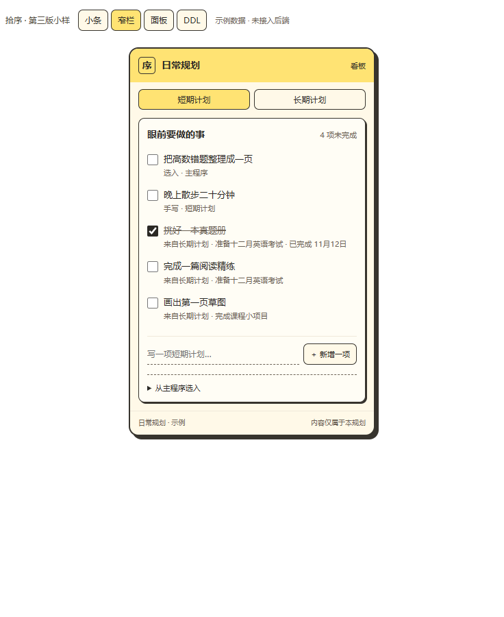
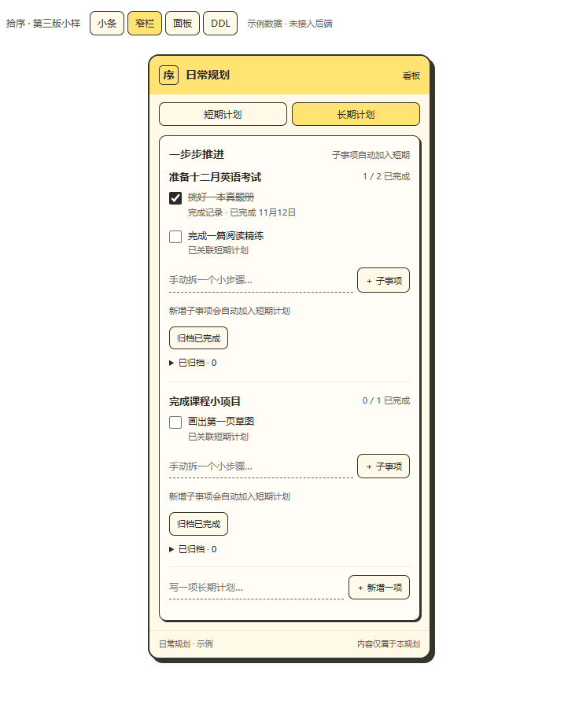
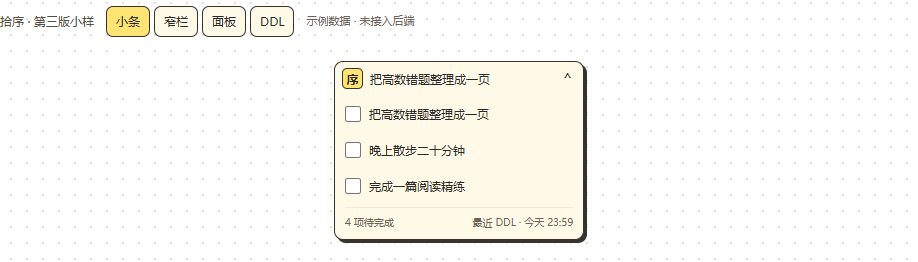
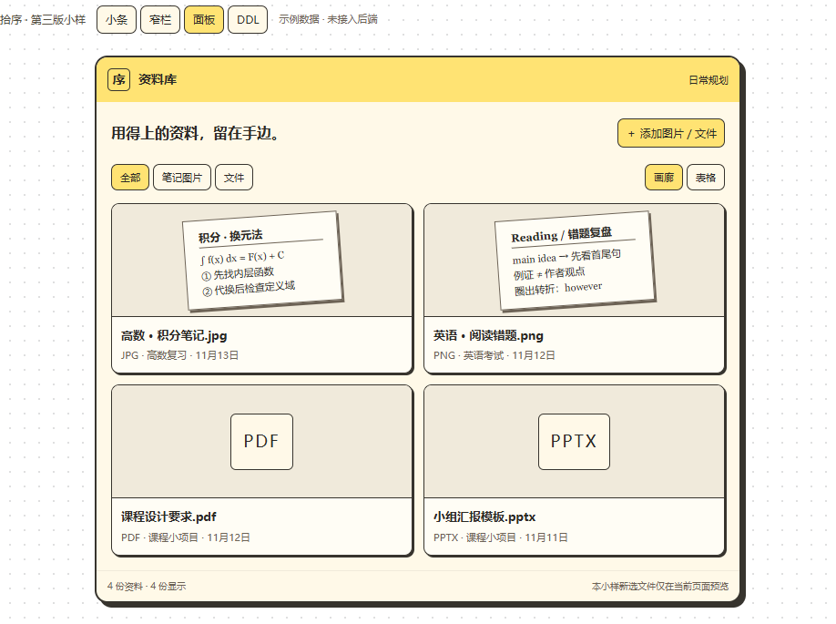
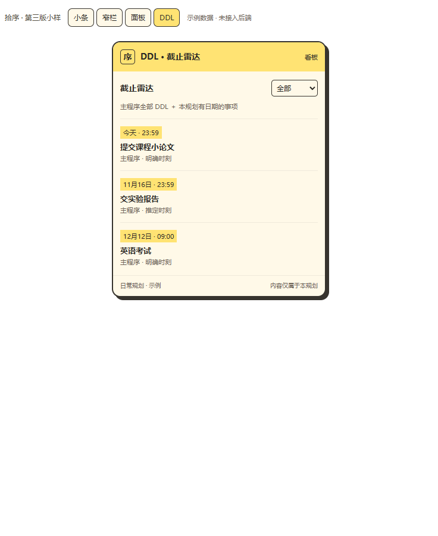

# 看板第三版：前端交接与新对话接续

2026-11-13，关联[#117](https://github.com/HYX-2024-1020/shixu/issues/117)。当前[最终企划](../desktop-board-plan-20261113.md)与[实施提示词](desktop-board-start-prompt-20261113.md)优先于[PR116初版](https://github.com/HYX-2024-1020/shixu/pull/116)。本页只记录已知事实和接回要求，不将外部前端或聊天小样当作产品实现。

## 当前状态及本轮停止点

| 环节 | 已知状态 |
| --- | --- |
| 原始企划PR116 | 已合入3159d26；当时还包含事件/DDL双页及随手记，后经用户反馈更新 |
| 三轮小样 | 第三版结构已确认；截图见下方。仅合成交互，未接真实账号/持久化/原生窗口 |
| 前端交接包 | 已提供独立第三版HTML、源片段、主程序当前合成截图、实际CSS节选、STYLE.md、PROMPT.md和校验清单，无完整仓库或业务数据 |
| 外部前端 | 用户明确已取得另一位agent制作的前端；本轮未收到可核对文件/路径，未读取源码、构建、验收或接入，不知道其实际覆盖程度 |
| 本轮工作 | 只将最终企划、术语、风格、接回清单和新对话提示词提交独立文档PR，不开展后端/安装/部署 |
| 下一阶段 | 用户新开对话并提供前端原件后，核验、受控接入主程序、完成后端及原生能力，按最终企划逐项验收 |

前端交接包由用户持有，本机材料位于工作区外层`outputs/desktop-board-frontend-handoff/`及`outputs/shixu-board-frontend-handoff.zip`，第三版测试/截图在`outputs/desktop-board-sample-20261113/`。这些是本机材料定位提示，不是公共仓库资源，也不是用户新取得的前端包；新机器没有时由用户提供，不把本页路径当成可下载地址。不扫描个人目录猜测外部前端位置。

## 用户最终调整，不可恢复旧版

1. 四同级入口：小条、窄栏、面板、DDL。
2. 窄栏顶部短期计划/长期计划双页签，各自下方新增一项；删除随手记与模块显示开关。
3. 长期计划内手动新增子事项，自动关联到短期；双向编辑/完成同步，不复制身份，完成/归档/恢复留痕。
4. 小条约250px，原地展开更多信息，不跳窄栏。
5. 面板是笔记图片/文件资料库，画廊与表格，不能只把计划模块重新排列。
6. DDL默认全部主程序来源加本规划有日期手写内容，独立于短期选入集合。

### 第三版结构参考

以下均为合成小样截图，只说明交互结构；外观以实际主程序样式为优先，不能将此较圆润的外框当最终规范。

## 主程序实际风格上下文

风格来源为当前源码的[desktop.css](../../src/bucket/desktop.css)、[card-visuals.css](../../src/bucket/card-visuals.css)、[card-palette.css](../../src/bucket/card-palette.css)及[设计约束](../../design/README.md)，交接包中只提取必要CSS与当前源码合成截图，无需外部agent读取整个项目。不要仅取`bucket.css`早期基础绿配色而忽略后加载的实际桌面样式。

| 要素 | 具体要求 |
| --- | --- |
| 主色 | 纸黄#fff9e6、墨黑#111/#171713、纸面#fffef8、亮黄#ffd43b |
| 点缀 | 粉#f783ac、紫#7048e8；任务#ffda32/#fff6ce、完成#a3dfbf/#e3f9ef，不随机给每行上色 |
| 形状 | 主程序3px描边、4px圆角、7px硬阴影按工具窗口缩小；看板外框约2px+3–4px阴影、4–6px圆角，行级不再层层套卡 |
| 字体 | Segoe UI、Microsoft YaHei、sans-serif；标题16–18px粗体、正文13–14px、说明11–12px；4/8/12/16间距 |
| 交互 | 黄底黑字选中、清楚的焦点轮廓，轻微位移/硬阴影反馈；保留减少动效，不循环跳动 |
| 边界 | 不用蓝紫渐变后台、毛玻璃、大胶囊、柔和模糊阴影；不照搬首页巨字、角色和大留白；样式限制作用域 |

主程序截图是实际源码在隔离headless Edge的合成预览，并非用户安装截图；角色只存在于参考截图，不新增或再分发角色资产。正式看板应像主程序里的紧凑工具窗口。

## 前端接回检查清单

- 保留用户原包，核对文件名/校验值/依赖锁文件/构建方法与第三方许可；没有原包先做现有接口调查，不声称前端已完成验收。
- 盘点React/TypeScript组件入口、样式作用域、mock adapter、状态及文件引用；禁止整份替换主程序、导入全局重置或夹带外部服务地址。
- 按最终企划列“已做/部分/未做”清单，尤其多份规划、父子稳定引用、完成日期、归档、离线、来源删除恢复、可靠文件留存、权限及失败反馈，不能只看外观截图。
- 真实入口是`src/main.tsx`默认的`src/bucket/BucketApp.tsx`；保留原桶/世界/DDL和#106/#112。`desktop/main.cjs`现有IPC只认主窗口，增加看板须精确授权，不整体放宽来源校验。
- props/action/adapter不是已实现后端。先核实账号、同步、备份、文件保存与生命周期契约，再实现真实持久化、跨窗口/离线一致性和本机窗口能力。
- 运行适用核心/同步/服务/浏览器/Windows回归，记录前端原包、接入提交、实际运行包、部署、用户原生安装与全屏兼容的不同证据。真实费用与个人资料不作为默认验证。

## 已有验证及未验证事项

此前小样验证：第三版短期/长期新增、子事项联动与勾选同步、归档恢复、四入口、DDL筛选、资料库/小条保留、320/390/736宽度无横向溢出、无页面脚本错误；独立导出断网验证新增父计划、小条展开、资料库表格、DDL通过。均是隔离合成验证，不覆盖未知的外部前端。

尚未验证外部前端源码/依赖、正式存储/服务/同步/备份、实际置顶/拖动/托盘与快捷键、Apple Music全屏及真实安装。资料库本页预览不能冒称可靠保存，文档PR不能冒称功能交付。

## 与其他任务隔离

[第二轮整改#118](https://github.com/HYX-2024-1020/shixu/issues/118)文档已由[PR119](https://github.com/HYX-2024-1020/shixu/pull/119)独立合入6cde830，本企划基于该最新主线，保留其词汇表、ADR、反馈清单及接续入口。看板实现不自动重启整轮整改，不向119追加提交。若发现真正阻塞看板或资料安全的依赖，明确记录后按任务边界处理。
